# Painel Macro Brasil

Painel de acompanhamento das contas nacionais, da moeda e das contas públicas do governo federal brasileiro, com dados do IBGE, do Banco Central e do Tesouro Nacional. O nome é provisório.

Cada página mostra a conta que fecha, e não só os gráficos: `Y = C + I + G + (X − M)` com os valores do último trimestre, a base monetária somada parcela a parcela, o resultado nominal como primário menos juros.

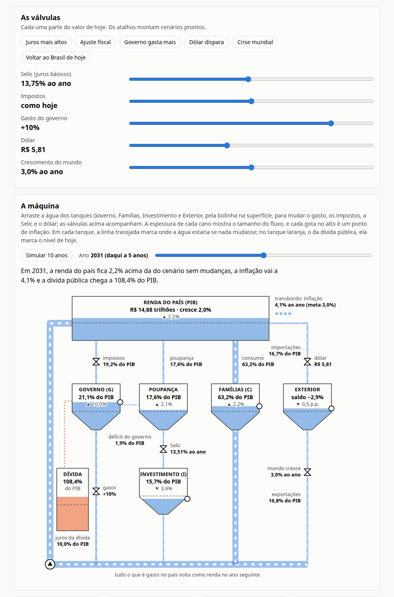

O painel ainda não está publicado em um endereço. Para vê-lo, [rode na sua máquina](#rodar-na-sua-máquina): leva cerca de um minuto e não exige instalar nada além do Python.

O desenho, as decisões e as pendências estão em [PLANEJAMENTO.md](PLANEJAMENTO.md).

## O que o painel mostra

São nove páginas. As imagens abaixo foram geradas em 19/11/2026, com os dados daquele dia.

| Página | Conteúdo |
|---|---|
| [Visão geral](#visão-geral) | Os oito números mais recentes e o que o mercado espera |
| [Atividade](#atividade) | PIB e sua decomposição pela ótica da despesa |
| [Moeda](#moeda) | Base monetária, M1 a M4, multiplicador e velocidade |
| [Fiscal](#fiscal) | Resultado primário e nominal, juros, receitas e despesas do Governo Central |
| [Dívida](#dívida) | Dívida bruta e líquida, composição, prazo e um simulador de trajetória |
| [Externo](#externo) | Transações correntes, balança comercial, investimento direto, reservas e câmbio |
| [Preços e juros](#preços-e-juros) | Inflação contra a meta, Selic e juro real |
| [Simulador](#simulador-da-economia) | A economia como tanques de água interligados |
| [Metodologia](#metodologia-e-fontes) | Fontes, fórmulas, aproximações e a lista de séries |

### Visão geral

A porta de entrada: o estado da economia em oito números, cada um com o período a que se refere.

- **Números de destaque**: crescimento do PIB, inflação em 12 meses, Selic, dólar, resultado primário, dívida bruta, transações correntes e crescimento do M1.
- **O que o mercado espera**: a mediana das previsões do Boletim Focus para o ano corrente e o seguinte, identificada como expectativa do mercado, não do governo nem do painel.
- **Atalhos** para as demais páginas, com uma linha sobre o que cada uma responde.

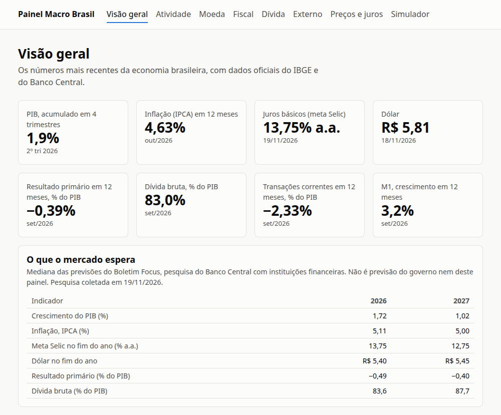

### Atividade

O PIB pela ótica da despesa: quem compra o que o país produz.

- **A conta do PIB** com os valores do último trimestre no lugar dos símbolos: `Y = C + I + G + (X − M)`.
- **Crescimento** acumulado em 4 trimestres e contra o trimestre anterior.
- **O que puxou o crescimento**: a contribuição de cada componente, em pontos percentuais. É um cálculo aproximado do painel, e a página avisa.
- **Participação** de consumo, investimento, governo e exportações líquidas no PIB.
- **Taxa de investimento**, crescimento por setor (agropecuária, indústria e serviços) e o IBC-Br, a prévia mensal do Banco Central.

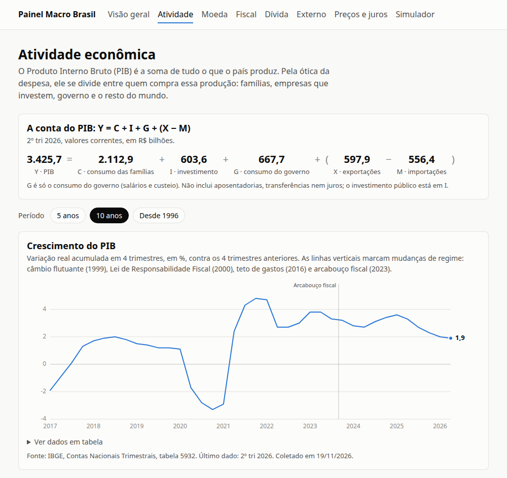

Todo gráfico tem dica ao passar o mouse e os mesmos dados em tabela:

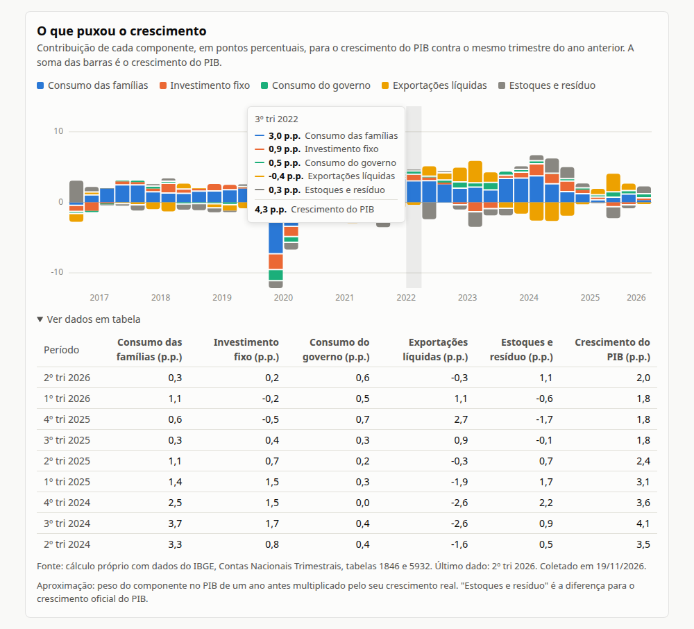

### Moeda

Quanto dinheiro existe na economia, do mais líquido ao mais amplo.

- **As contas da moeda**: base monetária = papel-moeda emitido + reservas bancárias, e M1 = papel-moeda em poder do público + depósitos à vista, com os saldos do último mês.
- **M1 a M4** em proporção do PIB.
- **Ritmo de expansão** da base, do M1 e do M4, comparado à inflação.
- **Multiplicador monetário** e **velocidade de circulação**, da equação de trocas `M · V = P · Y`.

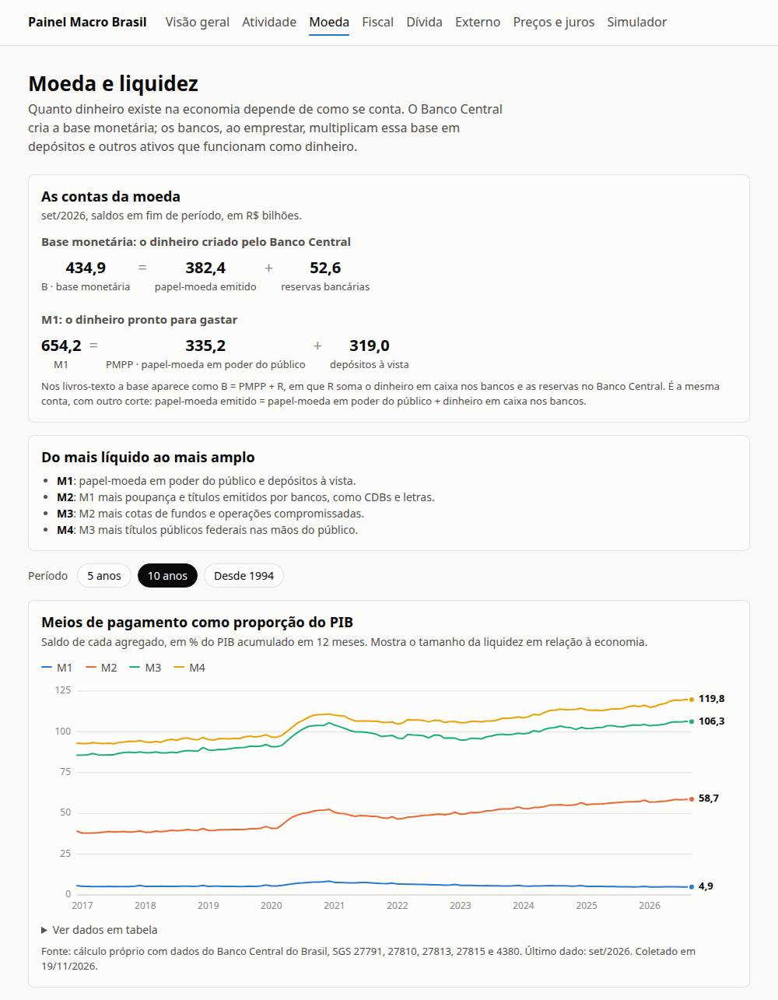

### Fiscal

O governo gasta mais do que arrecada? A resposta para o Governo Central: Tesouro Nacional, Previdência Social e Banco Central.

- **A conta do resultado**: nominal = primário − juros, em % do PIB e em reais, acumulada em 12 meses.
- **Resultado primário e nominal** ao longo do tempo; a distância entre as duas linhas é a conta de juros.
- **De onde vem o primário**: Tesouro, Previdência e Banco Central em separado.
- **Sinal invertido de propósito**: o Banco Central publica déficit como número positivo; aqui déficit é negativo, e a página explica.

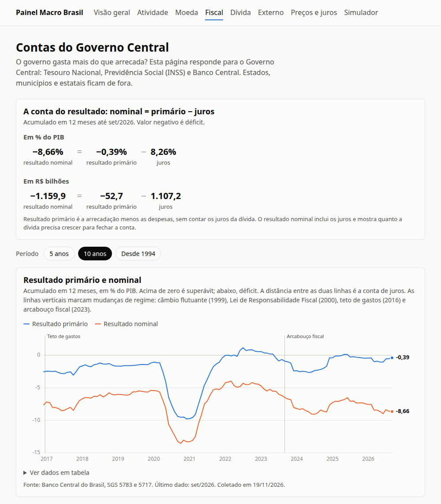

A segunda metade da página usa a planilha do Tesouro Nacional para abrir receitas e despesas:

- **A conta acima da linha**: primário = receita líquida − despesa.
- **Receita contra despesa** em proporção do PIB.
- **Para onde vai a despesa**: Previdência, pessoal, outras obrigatórias e despesas sujeitas à programação.

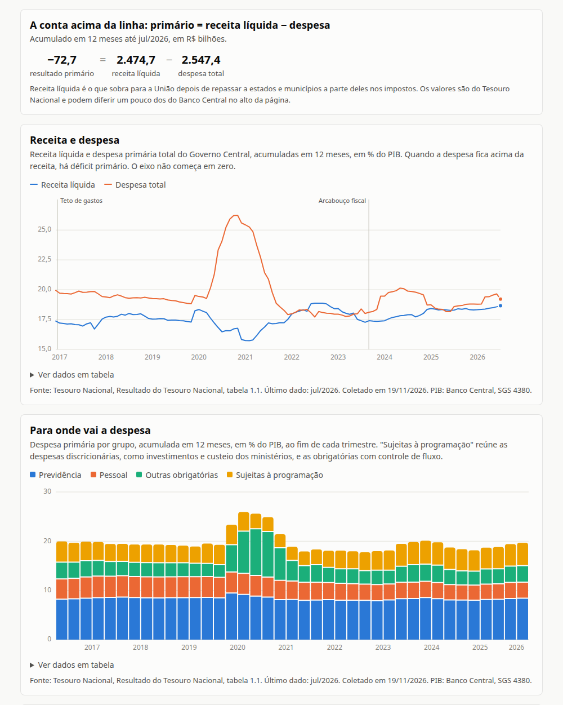

### Dívida

O tamanho da dívida em relação à economia, e do que ela depende.

- **Três números**: dívida bruta, dívida líquida e prazo médio dos títulos.
- **Dívida Bruta do Governo Geral e Dívida Líquida do Setor Público**, com a explicação da diferença entre as duas.
- **A que a dívida está atrelada**: parcela indexada à Selic, prefixada, à inflação e ao câmbio.
- **Prazo médio** dos títulos do Tesouro.

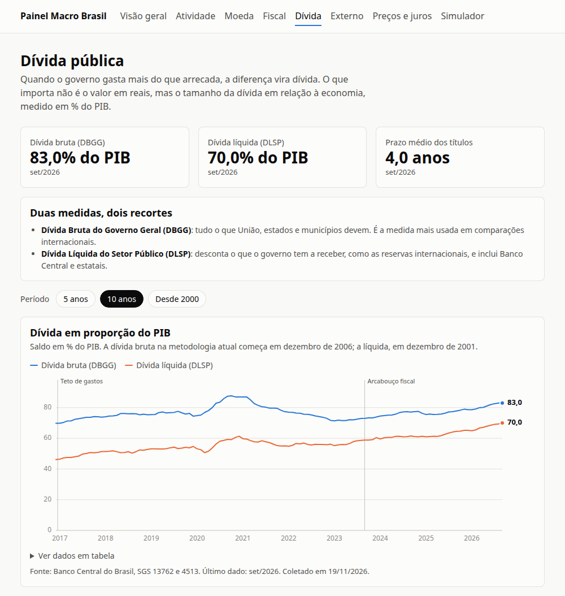

A página traz um simulador de trajetória da dívida. Três controles (juro real, crescimento do PIB e resultado primário) recalculam a dívida em 10 anos e o primário que a manteria parada. O ponto de partida são as expectativas do Boletim Focus.

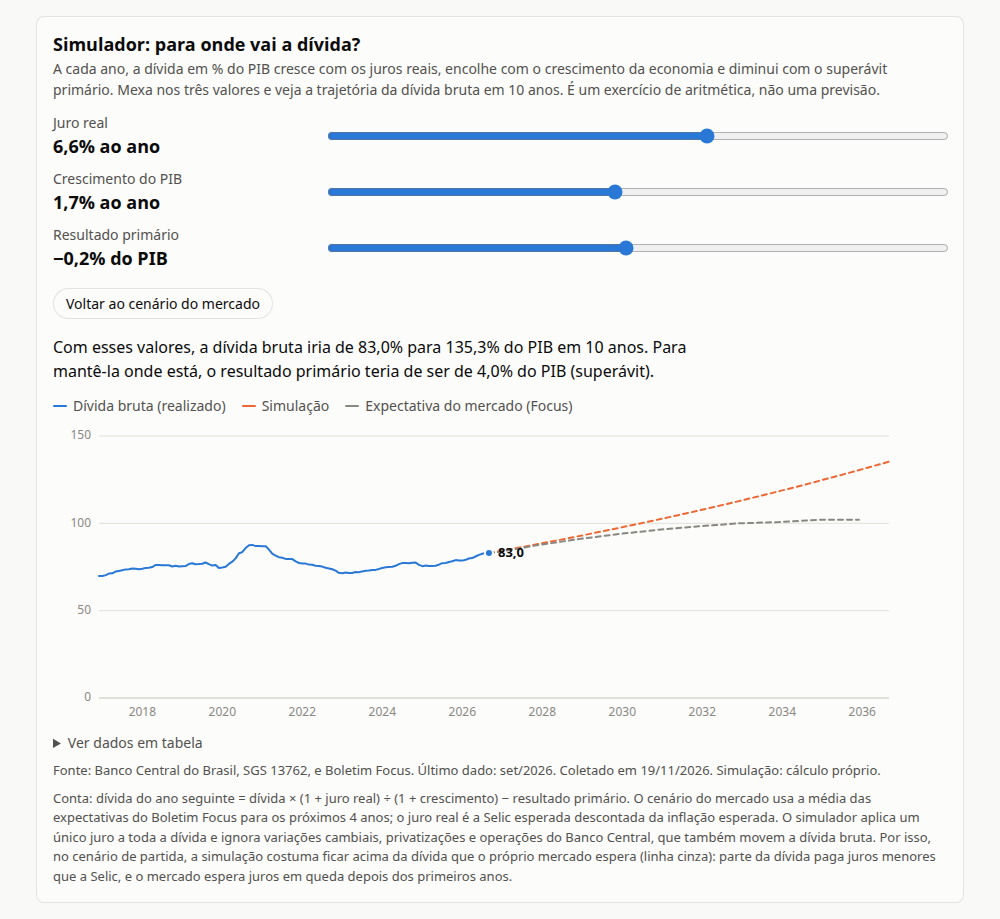

### Externo

As trocas do Brasil com o resto do mundo: o termo `(X − M)` da conta do PIB em detalhe.

- **Quatro números**: transações correntes, investimento direto, reservas e dólar.
- **Transações correntes** em proporção do PIB.
- **O investimento direto cobre o déficit?** As duas séries no mesmo gráfico.
- **Balança comercial**, **reservas internacionais** e a cotação diária do **dólar**.

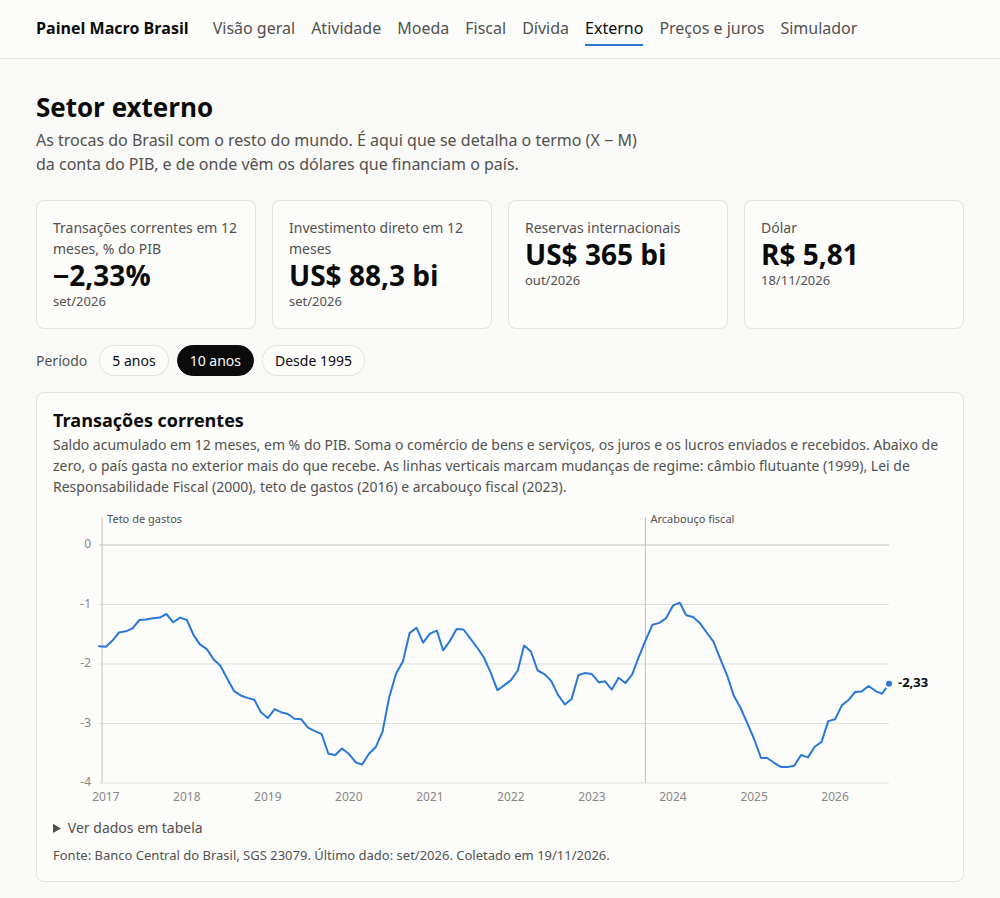

### Preços e juros

A inflação, a ferramenta do Banco Central para contê-la e a diferença entre as duas.

- **Inflação e meta**: IPCA em 12 meses contra a meta e contra a inflação que o mercado espera, em linha tracejada.
- **Taxa Selic** desde a criação da meta, em 1999.
- **Juro real** passado e esperado. O esperado é uma aproximação do painel, e a página avisa.

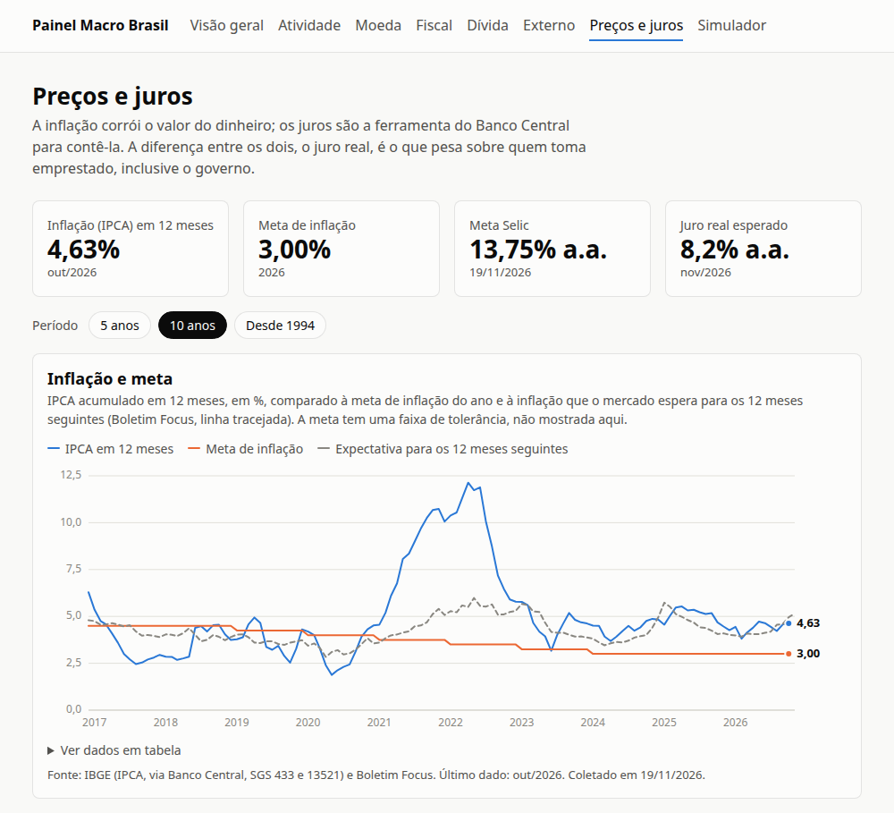

### Simulador da economia

A economia como uma máquina de água, inspirada na máquina hidráulica que o economista Bill Phillips construiu em 1949. A renda do país fica em um reservatório no alto e escoa para governo, famílias, poupança e exterior; tudo o que é gasto volta ao topo como a renda do ano seguinte.

- **Cinco válvulas**: Selic, impostos, gasto do governo, dólar e crescimento do mundo.
- **Atalhos de cenário**: juros mais altos, ajuste fiscal, governo gasta mais, dólar dispara e crise mundial.
- **Água arrastável**: nos tanques do governo, das famílias, do investimento e do exterior, puxa-se a água pela bolinha na superfície, e a válvula correspondente acompanha.
- **Passagem do tempo**: o botão "Simular 10 anos" faz os tanques encherem e esvaziarem ano a ano.
- **Leitura visual**: a espessura do cano é o tamanho do fluxo, cada gota no alto é um ponto de inflação e o tanque laranja é a dívida pública.

A imagem do topo desta página mostra o cenário "Governo gasta mais". Abaixo da máquina, seis números e quatro gráficos comparam o cenário escolhido com o que aconteceria sem mudanças:

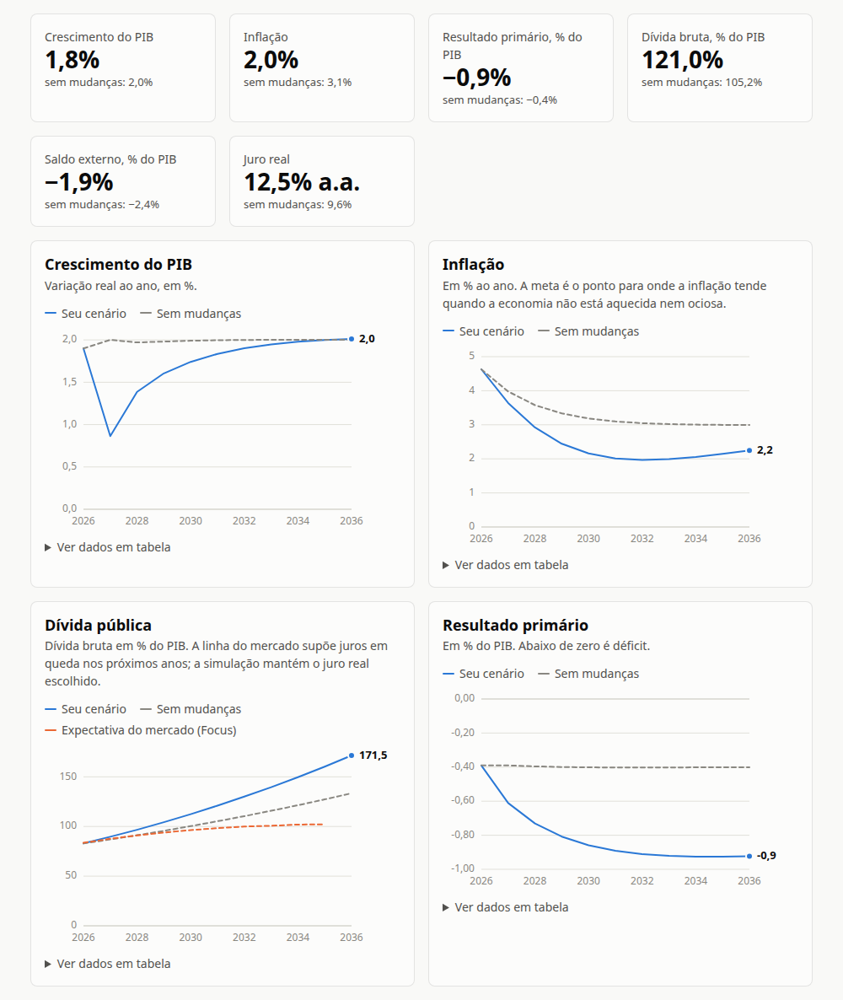

O ponto de partida do simulador são dados reais, mas as reações são didáticas: quanto o investimento cai quando o juro sobe, por exemplo, é um valor de livro-texto, não uma estimativa. Ele mostra a direção e a ordem de grandeza dos efeitos, e não é uma previsão.

### Metodologia e fontes

De onde vêm os números, como são calculados e o que o painel não mostra.

- **Fontes** com link para cada uma, e a explicação de por que os gráficos de uma página podem terminar em meses diferentes.
- **As contas** e os **cálculos próprios**, listados um a um.
- **De que governo se está falando**: Governo Central, Governo Geral e Setor Público Consolidado.
- **As sensibilidades do simulador**, em tabela.

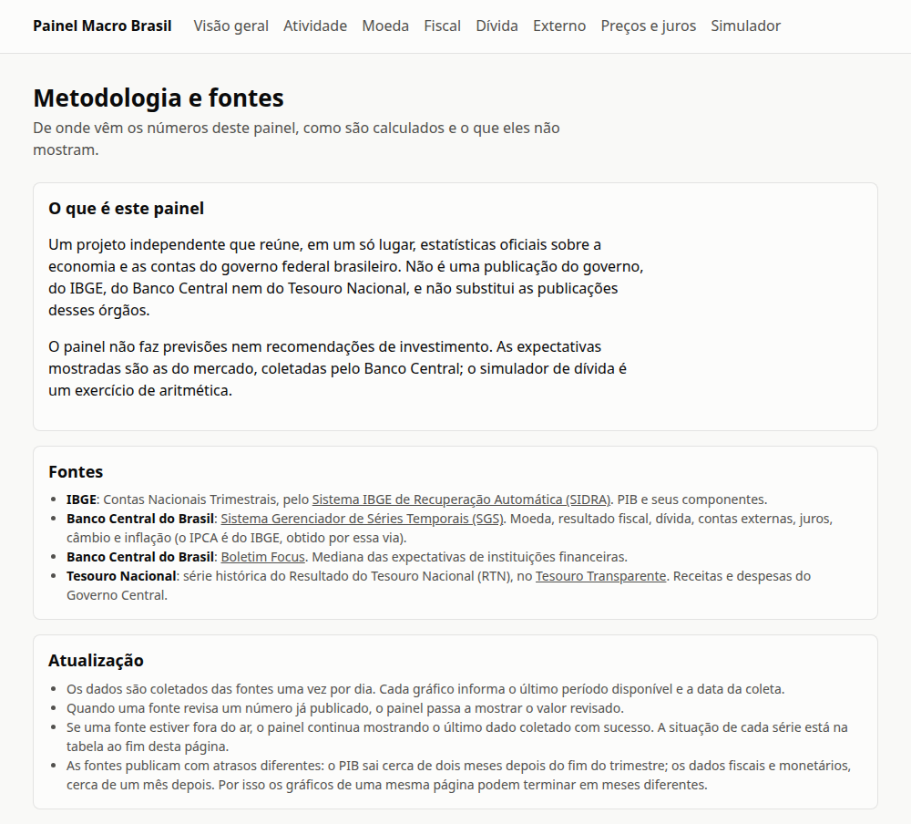

A tabela de séries é gerada pela própria coleta: mostra fonte, unidade, periodicidade e a data da última coleta de cada série, e avisa quando a última tentativa falhou.

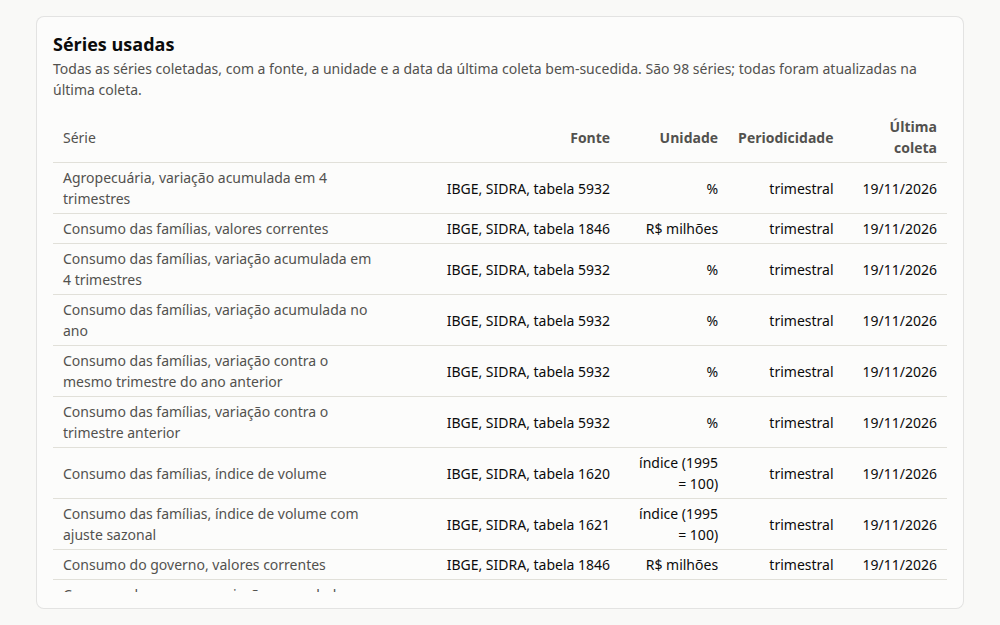

### Em todas as páginas

- **Período**: 5 anos, 10 anos ou o histórico completo, que começa no Plano Real (1994) quando a série existe desde então.
- **Dica e tabela**: cada gráfico responde ao mouse, ao toque e às setas do teclado, e oferece os mesmos dados em tabela.
- **Fonte em cada gráfico**: origem, último período disponível e data da coleta.
- **Mudanças de regime** marcadas nos gráficos de linha: câmbio flutuante (1999), Lei de Responsabilidade Fiscal (2000), teto de gastos (2016) e arcabouço fiscal (2023).
- **Tema claro e escuro**, seguindo a preferência do sistema, e leitura em celular.

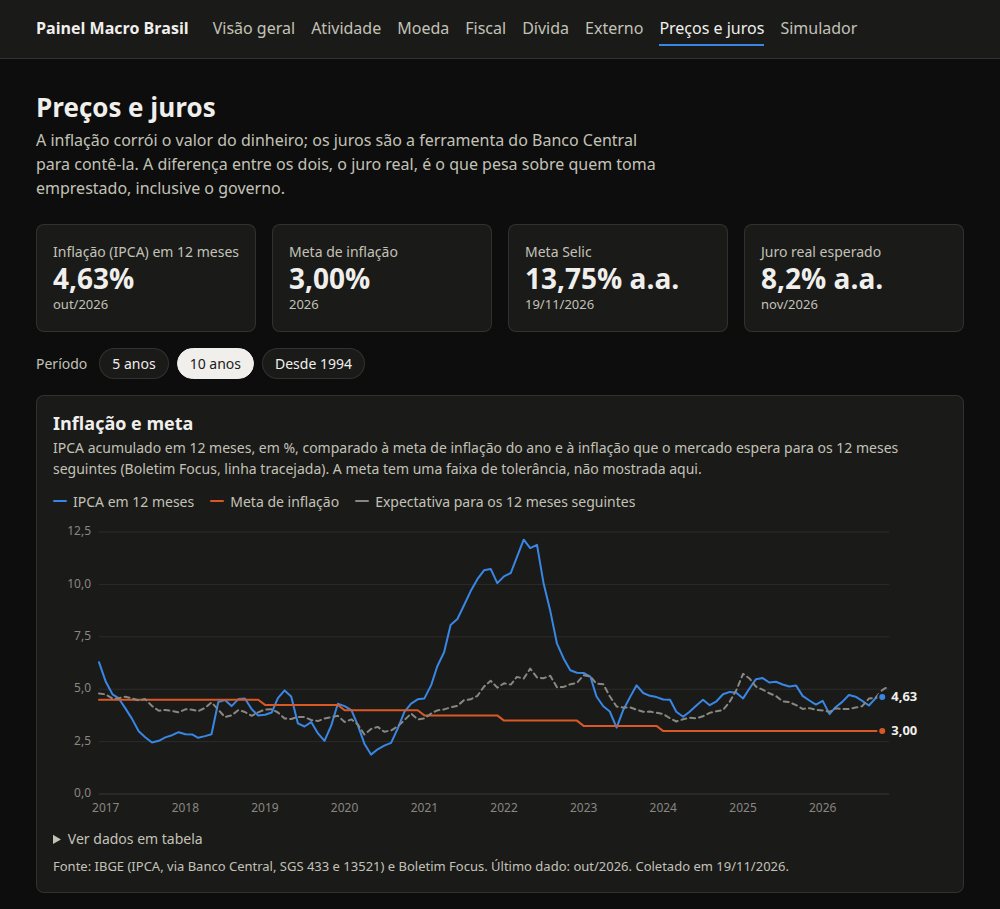

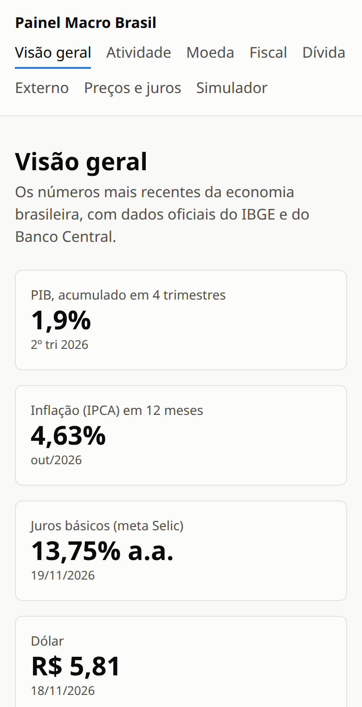

## Como funciona

- `collector/collect.py` busca as séries listadas em `collector/catalog.json`, grava em um banco SQLite e exporta um arquivo JSON por série.
- `site/` é um site estático em HTML, CSS e JavaScript puro, que lê esses arquivos JSON.
- Nada além da biblioteca padrão do Python e de um navegador é necessário.

## Rodar na sua máquina

```sh
python3 collector/collect.py                      # coleta tudo (cerca de 1 minuto)
python3 -m http.server 8765 --directory site      # abra http://127.0.0.1:8765
```

Para coletar só algumas séries: `python3 collector/collect.py m1 pib_corrente`.

## Testes

```sh
python3 -m unittest discover collector            # coleta
node --test                                       # contas e formatação do site
```

## Atualizar as capturas de tela

```sh
python3 collector/collect.py          # as imagens usam os dados coletados
node tools/screenshots.mjs            # grava em docs/screenshots/
```

Precisa do Google Chrome ou do Chromium instalado; o executável pode ser indicado na variável `CHROME`. Não usa pacotes.

## Publicar em um servidor com Docker

1. Instale o Docker no servidor e clone este repositório.
2. Aponte o domínio para o servidor e libere as portas 80 e 443.
3. Crie o arquivo `.env` a partir do modelo e preencha o domínio:
   ```sh
   cp .env.example .env
   ```
4. Faça a primeira coleta e suba o site:
   ```sh
   docker compose --profile collect run --rm collector
   docker compose up -d
   ```
5. Agende a coleta diária no agendador do servidor (`crontab -e`), trocando o caminho:
   ```
   CRON_TZ=America/Sao_Paulo
   0 5 * * * cd /caminho/do/repositorio && docker compose --profile collect run --rm collector >> coleta.log 2>&1
   ```

Com `SITE_ADDRESS` preenchido no `.env`, o certificado HTTPS é obtido e renovado automaticamente. Sem ele, o site responde só em HTTP na porta 80.

## Atualizar o site publicado

```sh
git pull
docker compose up -d --build
```

Os dados coletados ficam em volumes do Docker e não são afetados pela atualização.

## Onde ficam os dados no servidor

| Volume | Conteúdo |
|---|---|
| `db` | Banco SQLite com todas as observações. Não é servido ao público. É o que vale guardar em backup; pode ser refeito com uma nova coleta completa. |
| `export` | Arquivos JSON lidos pelo site. São regerados a cada coleta. |
| `caddy_data` | Certificados HTTPS. |

## Acrescentar uma série

Inclua uma linha em `collector/catalog.json` e rode a coleta. A série passa a existir em `site/data/<id>.json` e aparece na tabela da página de metodologia.

## Licença

O código deste repositório está sob a [licença MIT](LICENSE).

Os dados não fazem parte do repositório: são coletados do IBGE, do Banco Central do Brasil e do Tesouro Nacional, que continuam sendo os responsáveis por eles. Quem reutilizar o painel deve citar essas fontes e observar as condições de uso de cada uma.
